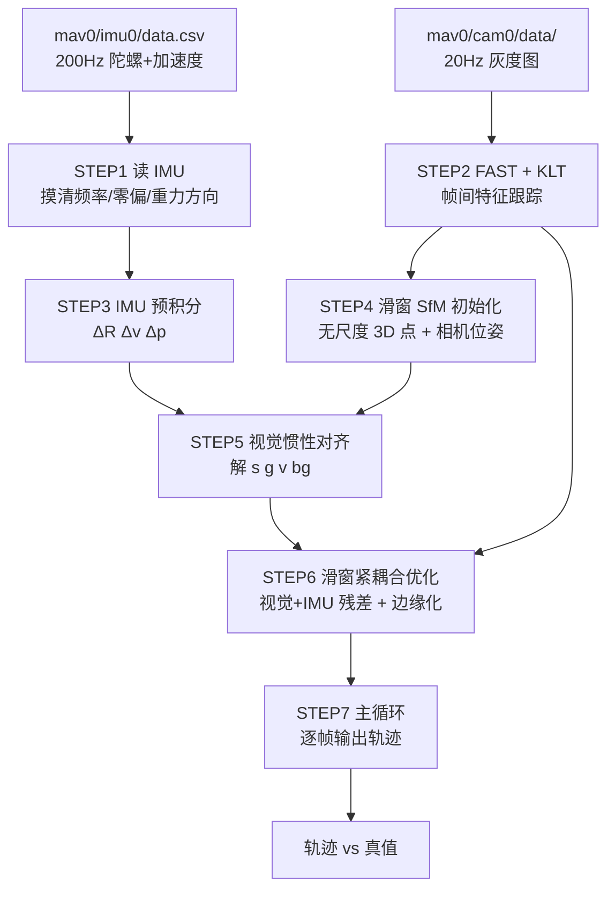

# 七步与 VINS 真实数据流的映射

## 为什么要按「真实模块边界」切七刀

如果按教科书切（相机模型 / 对极几何 / 三角化 / 优化），切出来的是知识章节，跑出来的是一堆互不相干的 demo。按 VINS 的真实模块切，切出来的是**同一条数据流上的七个工位**：每个工位的输入就是上一个工位的输出，最后能串成一整条轨迹。

因此这七步不是七个练习，而是七段流水线。

## 数据流全景

## 七步 ↔ 官方代码对照

| 本仓库 | VINS-Mono 官方位置 | 官方实现的关键动作 |
|---|---|---|
| STEP1 | `vins_estimator/src/parameters.cpp` 读参 + IMU 回调 | 读 `imu0/data.csv`、检查采样频率、估重力方向 |
| STEP2 | `vins_estimator/src/featureTracker/feature_tracker.cpp` | `goodFeaturesToTrack` + `calcOpticalFlowPyrLK`（3 层金字塔，21×21 窗口）+ 前后向误匹配剔除 |
| STEP3 | `vins_estimator/src/factor/integration_base.h` | `IntegrationBase::propagate()` 与 `midPointIntegration()`，中值积分递推 PVQ |
| STEP4 | `vins_estimator/src/initial/initial_sfm.cpp` | `GlobalSFM::construct()`：选参考帧 → 本质矩阵 → `recoverPose` → 三角化 → 其余帧 PnP → 全局 BA |
| STEP5 | `vins_estimator/src/initial/initial_alignment.cpp` | `solveGyroscopeBias()` 解 bg → `LinearAlignment()` 解 s/g/v → `RefineGravity()` 球面参数化细化 |
| STEP5 附 | `vins_estimator/src/initial/initial_ex_rotation.cpp` | `CalibrationExRotation` 标定相机-IMU 外参 R_ic；本仓库直接从 `sensor.yaml` 读 |
| STEP6 | `vins_estimator/src/estimator.cpp` | 构造视觉/IMU 残差因子，滑窗 10 帧联合优化，`marginalization` 边缘化最老帧 |
| STEP7 | `vins_estimator/src/estimator.cpp::processImage` + `estimator_node.cpp` | 逐帧 IMU 预积分 → 特征跟踪 → 初始化判定 → 滑窗优化 → 发布位姿 |

## 七步之间传递的具体量

| 交接点 | 上游产出 | 下游用途 |
|---|---|---|
| STEP2 → STEP4 | 每个特征在 6 帧滑窗里的像素坐标链 | 三角化与重投影残差 |
| STEP2 → STEP4 | 每帧的像素坐标 + 去畸变归一化坐标 | 几何计算统一用归一化坐标，可视化用像素 |
| STEP1 → STEP3 | 每帧时刻相邻的 IMU 采样序列 | 中值积分输入 |
| STEP3 → STEP5 | 相邻帧对的 ΔR / Δv / Δp | 与视觉 ΔR / Δp 联立解 s 与 g |
| STEP4 → STEP5 | 无尺度位姿（t 只差一个 s） | 线性对齐的视觉侧约束 |
| STEP5 → STEP6 | 尺度 s、重力方向 g、速度 v、陀螺零偏 bg | 紧耦合优化的初值与状态量 |
| STEP6 → STEP7 | 每帧优化后位姿 | 拼成连续轨迹 |

## 一个容易忽略的事实

STEP4 输出的位姿**没有尺度**。单目恢复出来的 t 只能确定方向，长度是任意单位。这既不是 bug 也不是近似，是单目本身的自由度。STEP5 的真正任务就是把这个自由度用 IMU 的加速度测量消掉 —— 所以 STEP5 不是「可选的一步」，而是单目 VINS 能输出米制轨迹的唯一通道。

理解这一点，才能明白为什么 STEP4 的验收标准里只有「重投影误差」，没有「绝对位置精度」。
